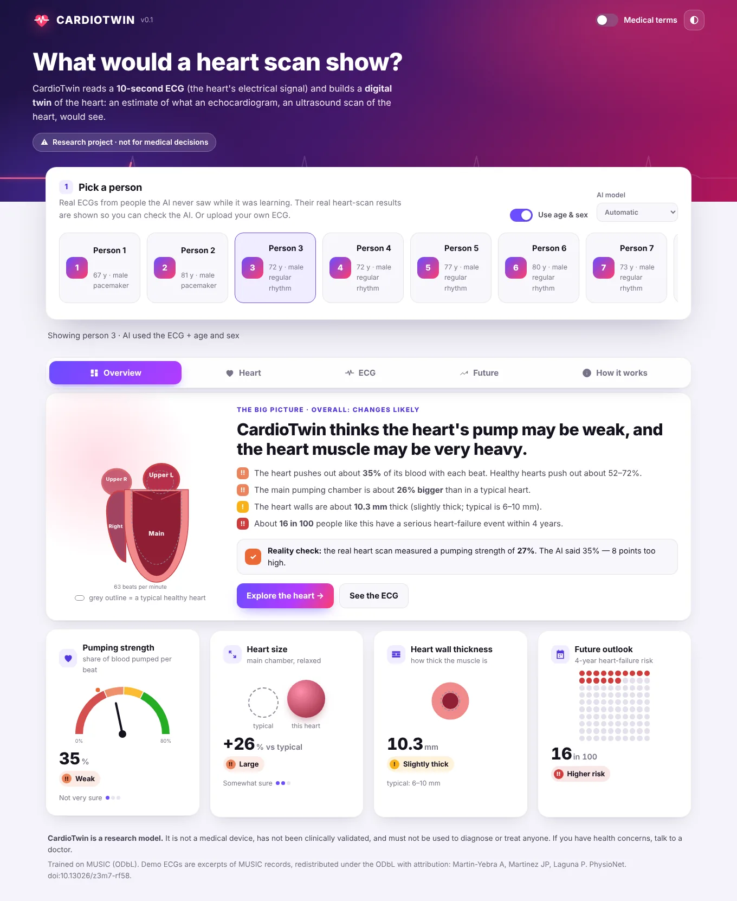
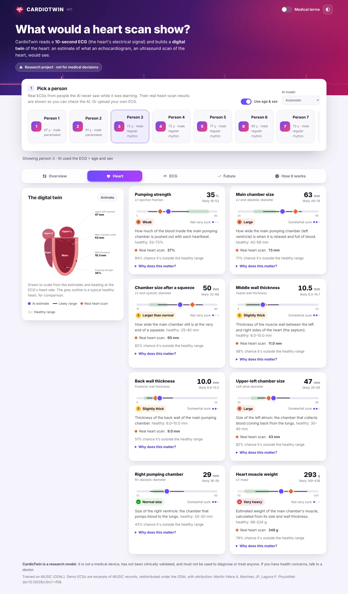
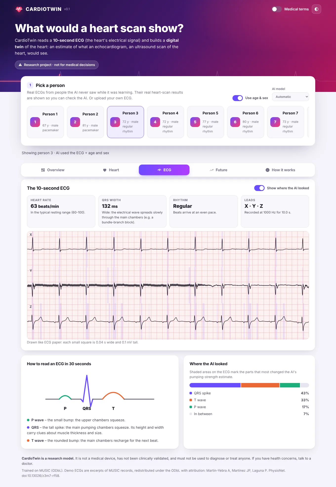
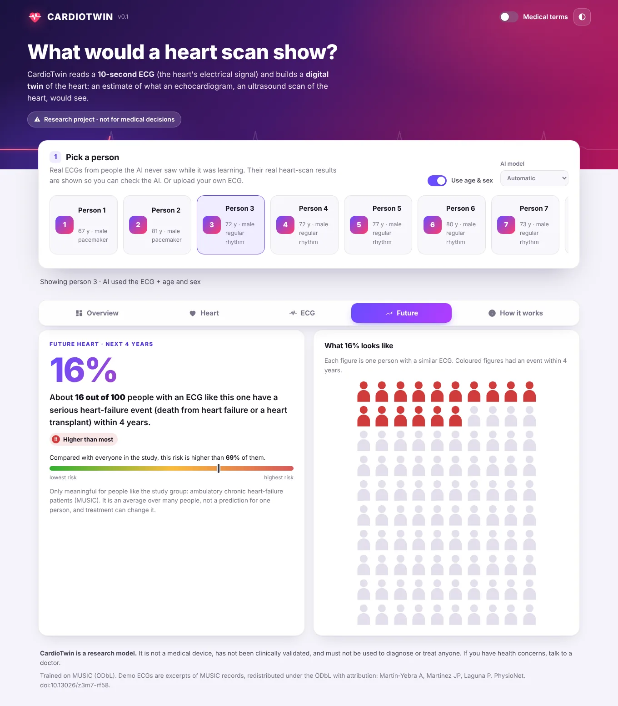

# CardioTwin

**Give an AI a 10-second ECG and have it estimate what an echocardiogram would show.**

CardioTwin reads a standard 10-second ECG and estimates the heart's structure and
function - ejection fraction, chamber sizes, wall thickness, LV mass - each with an
uncertainty interval, draws the result as an animated "digital twin" of the heart, and
estimates the future: risk of heart-failure events (MUSIC) or the next echo 6-12 months
later (MIMIC-IV).

> **Research software. Not a medical device.** CardioTwin has not been clinically
> validated and must not be used to diagnose or treat anyone.



The dashboard explains everything in plain English (flip the **Medical terms** switch for the
clinical names) across five tabs:

| Heart | ECG | Future |
|---|---|---|
|  |  |  |

Dark mode is built in: [screenshot](docs/img/dashboard-dark.webp).

## Results so far (real data: MUSIC, 685 heart-failure patients)

The full report with confidence intervals, figures and statistics is
[reports/music/REPORT.md](reports/music/REPORT.md). Headlines, on **135 held-out patients**
the model never saw, using **one 10-second ECG** each:

| | Test set (n = 135) | Cross-validation (n = 550) |
|---|---|---|
| EF error (MAE) | 10.3 points (95% CI 9.0-11.9) | 9.7 points |
| EF correlation with echo (r) | 0.38 (0.20-0.55) | 0.44 |
| Detecting EF <= 40% (AUROC) | 0.71 (0.60-0.80) | 0.75 |
| LV end-systolic diameter (r) | 0.49 (0.33-0.62) | 0.43 |
| Left atrial diameter (r) | 0.52 (0.40-0.63) | 0.33 |
| 4-year heart-failure death/transplant (C-index) | 0.64 (0.52-0.76), vs 0.51 for age+sex and 0.71 for the actual echo | - |

What this means, honestly:

* **There is echo information in a 10-second ECG**, beyond age and sex: in cross-validation the
  ECG model beats age+sex for every chamber measurement (EF r 0.44 vs 0.18) and modestly beats
  classic hand-measured ECG features for EF (r 0.36) and LV size (but not LV mass). On the
  smaller test set the differences between ECG models are within the confidence intervals.
* **It is a weak-to-moderate signal in this cohort.** MUSIC is small (550 training patients) and
  almost everyone has heart failure (mean EF 37%), which makes the problem hard; published
  ECG-AI EF models used tens of thousands of patients from general hospital populations. That is
  exactly what MIMIC-IV provides, and the pipeline is ready for it.
* **The ECG-derived heart predicts the future**: patients CardioTwin ranks as high-risk had a 24%
  4-year event rate vs 9% for the low-risk third (Level 12-14).
* **Leakage is real** (Level 8): splitting by 10-second window instead of by patient makes the
  same network look 3x better (EF error 3.1 vs 9.8 points, r 0.96 vs 0.51).
* **The uncertainty is honest**: 88-96% of true values fall inside the 90% intervals.
* **Transfer learning helps**: pretraining on PTB-XL raised cross-validated left-atrial r from
  0.04 to 0.34 (see [reports/music/TUNING.md](reports/music/TUNING.md)).
* The bundled model is trained on heart-failure patients: for people with healthy hearts its
  estimates are biased toward abnormal. Treat it as a research demonstration.


## Quick start

New to this? Follow the **[step-by-step tutorial](docs/TUTORIAL.md)** (install, dashboard tour, your own ECGs, reproducing the research).

```bash
git clone https://github.com/ishaanmandala/cardiotwin && cd cardiotwin
python3 -m venv .venv && source .venv/bin/activate   # needs Python 3.10+ (the Mac's built-in 3.9 is too old)
python -m pip install --upgrade pip
pip install -e ".[dev]"            # installs PyTorch, wfdb, FastAPI, ...

cardiotwin serve                   # dashboard at http://127.0.0.1:8000 (bundled MUSIC model + demo ECGs)
cardiotwin predict --demo demo03   # the same, in the terminal
cardiotwin predict my_ecg.csv --age 63 --sex F   # your own ECG (WFDB, CSV, NPZ, NPY or JSON)
```

Example terminal output (`cardiotwin predict --demo demo03`):

```
$ cardiotwin predict --demo demo03
Model: CardioTwin v0.1 (MUSIC, X/Y/Z leads) - ECG + age + sex (CardioTwin)

CARDIOTWIN  -  Estimated Heart Profile
(research model - NOT for diagnosis)

LV ejection fraction         ####......   34.7% +/-19  Moderately reduced   [echo: 27%]
LV end-diastolic diameter    ######....   63.2 mm +/-14  Moderately enlarged   [echo: 73 mm]
LV end-systolic diameter     #####.....   50.1 mm +/-18  Enlarged   [echo: 60 mm]
Septal wall thickness        ###.......   10.5 mm +/-4   Mildly thickened   [echo: 11 mm]
Posterior wall thickness     ###.......   10.0 mm +/-3   Mildly thickened   [echo: 9 mm]
Left atrial diameter         ####......   46.8 mm +/-12  Moderately enlarged   [echo: 43 mm]
RV diastolic diameter        ####......   28.8 mm +/-11  Normal
LV mass                      #####.....  293.4 g +/-144 Severely increased   [echo: 346 g]

Structural abnormality risk: HIGH

FUTURE HEART
  Heart-failure death or transplant: 16% (HIGH)
```

Two 12-lead example ECGs to upload are in [examples/](examples/).

## What is in here

| Level | What | How |
|---|---|---|
| 5 | Plot an ECG on ECG paper | `cardiotwin plot-ecg <record> --clean` |
| 6 | Pair MIMIC-IV ECGs with echoes (within 24 h) | `cardiotwin build-mimic --config configs/mimic.yaml` |
| 7-10 | Train ECG -> EF and ~10 echo measurements, patient-level splits, baselines | `cardiotwin experiment configs/music.yaml` |
| 11, 14 | The digital-twin dashboard | `cardiotwin serve` |
| 12-13 | Future heart: later echo / change in EF / follow-up events | `future_lvef`, `delta_lvef`, survival analysis |
| 15-18 | Explainability, subgroups, statistics | in every experiment report |

The full mapping from the original blueprint to code is in [docs/ROADMAP.md](docs/ROADMAP.md).

## Data

| Dataset | Access | Used for |
|---|---|---|
| [MUSIC](https://physionet.org/content/music-sudden-cardiac-death/) | open (ODbL), downloaded automatically | real ECG + echo + outcomes: the bundled model |
| [PTB-XL](https://physionet.org/content/ptb-xl/) | open (CC BY 4.0), downloaded automatically | pretraining the ECG encoder |
| [MIMIC-IV-ECG](https://physionet.org/content/mimic-iv-ecg/) + [MIMIC-IV-Echo](https://physionet.org/content/mimic-iv-echo/) | credentialed | the main study (see [docs/MIMIC_ACCESS.md](docs/MIMIC_ACCESS.md)) |
| synthetic | generated | tests, tutorials, pipeline checks (`cardiotwin synth`) |

### Reproduce the MUSIC results (~1 h on a 4-core CPU, no GPU needed)

```bash
cardiotwin download-music          # 1.2 GB: 5-minute ECG excerpts of 687 patients + clinical data
cardiotwin build-music
cardiotwin download-ptbxl          # 0.6 GB (optional: the pretrained encoder is bundled in models/encoders/)
cardiotwin pretrain --leads xyz --vcg-z-anterior --out models/encoders/ptbxl-xyz.pt
cardiotwin experiment configs/music.yaml
cardiotwin report configs/music.yaml   # optional: rebuild the report from saved predictions
```

The report lands in `reports/music/REPORT.md`; the deployable models in `models/`.

### Put it on a website

Free on Hugging Face Spaces in about 10 minutes, or on any Docker host with the included
`Dockerfile`: see **[docs/DEPLOY.md](docs/DEPLOY.md)**.

### Run it on MIMIC-IV

Follow [docs/MIMIC_ACCESS.md](docs/MIMIC_ACCESS.md) (credentialing, download, column
check), then:

```bash
cardiotwin build-mimic --config configs/mimic.yaml
cardiotwin pretrain --leads 12 --out models/encoders/ptbxl-12lead.pt
cardiotwin experiment configs/mimic_experiment.yaml
```

Never commit MIMIC data or per-patient outputs; `data/` and `runs/` are git-ignored.

## Learning path

New to Python? The `tutorials/` folder walks through Levels 4-9 with heavily commented scripts:

1. `01_first_ecg.py` - read and plot one real ECG (numpy, wfdb, matplotlib)
2. `02_echo_table.py` - find EF in a table and match ECGs to echoes (pandas)
3. `03_dumb_ai.py` - a tiny PyTorch model, ECG in, EF out, with a patient-level split
4. `04_baselines.py` - does the ECG beat age and sex?

## How it works

```
10-s ECG (any leads, any sampling rate)
  -> clean: resample to 250 Hz, 0.5-45 Hz band-pass, mains notch, derive missing leads
  -> 1-D ResNet encoder (pretrained on PTB-XL)  [+ age, sex]
  -> one head per echo measurement: estimate + uncertainty
  -> ensemble of 5 cross-validation models
  -> digital twin: ASE reference ranges, abnormality probabilities, future-risk model
```

Code map (`src/cardiotwin/`):

| Module | Role |
|---|---|
| `ecg/` | reading files, filters, hand-made ECG features, ECG-paper plots |
| `data/` | MIMIC pairing, MUSIC and PTB-XL loaders, synthetic data, patient-level splits, signal store |
| `models/`, `training/` | the network, multi-task loss, trainer, baselines |
| `evaluation/` | metrics with patient-level bootstrap, survival analysis, figures, report |
| `experiments.py` | the full research protocol |
| `pretrain.py` | PTB-XL transfer learning |
| `twin.py`, `inference.py` | heart profile and the predictor |
| `app/` | FastAPI server and dashboard |

## Tests

```bash
pytest -m "not slow"   # ~1 min: unit tests
pytest -m slow         # ~5 min: trains small models end-to-end on synthetic data
```

## Citing the data

* MUSIC: Martin-Yebra A, Martinez JP, Laguna P. MUSIC (Sudden Cardiac Death in Chronic Heart
  Failure). PhysioNet. doi:10.13026/z3m7-rf58; and Martin-Yebra A, et al. Computing in
  Cardiology 2024;51. doi:10.22489/CinC.2024.355
* PTB-XL: Wagner P, et al. PTB-XL, a large publicly available electrocardiography dataset.
  Scientific Data 2020;7:154. doi:10.13026/kfzx-aw45
* MIMIC-IV-ECG / MIMIC-IV-Echo: see the PhysioNet project pages.
* PhysioNet: Goldberger AL, et al. Circulation 2000;101(23):e215-e220.

Reference ranges for the heart profile: Lang RM, et al. Recommendations for cardiac chamber
quantification by echocardiography in adults. J Am Soc Echocardiogr 2015;28:1-39.
