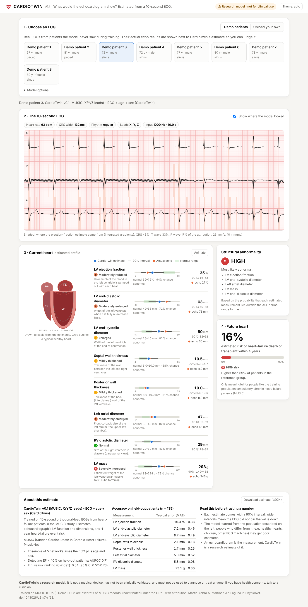

# CardioTwin

**Give an AI a 10-second ECG and have it estimate what an echocardiogram would show.**

CardioTwin reads a standard 10-second ECG and estimates the heart's structure and
function - ejection fraction, chamber sizes, wall thickness, LV mass - each with an
uncertainty interval, draws the result as an animated "digital twin" of the heart, and
estimates the future: risk of heart-failure events (MUSIC) or the next echo 6-12 months
later (MIMIC-IV).

> **Research software. Not a medical device.** CardioTwin has not been clinically
> validated and must not be used to diagnose or treat anyone.



<!-- RESULTS -->

## Quick start

```bash
git clone https://github.com/ishaanmandala/cardiotwin && cd cardiotwin
python -m venv .venv && source .venv/bin/activate
pip install -e ".[dev]"            # Python 3.10+; installs PyTorch, wfdb, FastAPI, ...

cardiotwin serve                   # dashboard at http://127.0.0.1:8000 (bundled MUSIC model + demo ECGs)
cardiotwin predict --demo demo03   # the same, in the terminal
cardiotwin predict my_ecg.csv --age 63 --sex F   # your own ECG (WFDB, CSV, NPZ, NPY or JSON)
```

Example terminal output (`cardiotwin predict --demo demo03`):

<!-- PREDICT_EXAMPLE -->

## What is in here

| Level | What | How |
|---|---|---|
| 5 | Plot an ECG on ECG paper | `cardiotwin plot-ecg <record> --clean` |
| 6 | Pair MIMIC-IV ECGs with echoes (within 24 h) | `cardiotwin build-mimic --config configs/mimic.yaml` |
| 7-10 | Train ECG -> EF and ~10 echo measurements, patient-level splits, baselines | `cardiotwin experiment configs/music.yaml` |
| 11, 14 | The digital-twin dashboard | `cardiotwin serve` |
| 12-13 | Future heart: later echo / change in EF / follow-up events | `future_lvef`, `delta_lvef`, survival analysis |
| 15-18 | Explainability, subgroups, statistics | in every experiment report |

The full mapping from the original blueprint to code is in [docs/ROADMAP.md](docs/ROADMAP.md).

## Data

| Dataset | Access | Used for |
|---|---|---|
| [MUSIC](https://physionet.org/content/music-sudden-cardiac-death/) | open (ODbL), downloaded automatically | real ECG + echo + outcomes: the bundled model |
| [PTB-XL](https://physionet.org/content/ptb-xl/) | open (CC BY 4.0), downloaded automatically | pretraining the ECG encoder |
| [MIMIC-IV-ECG](https://physionet.org/content/mimic-iv-ecg/) + [MIMIC-IV-Echo](https://physionet.org/content/mimic-iv-echo/) | credentialed | the main study (see [docs/MIMIC_ACCESS.md](docs/MIMIC_ACCESS.md)) |
| synthetic | generated | tests, tutorials, pipeline checks (`cardiotwin synth`) |

### Reproduce the MUSIC results (~1.5 h on a 4-core CPU, no GPU needed)

```bash
cardiotwin download-music          # 1.2 GB: 5-minute ECG excerpts of 687 patients + clinical data
cardiotwin build-music
cardiotwin download-ptbxl          # 0.6 GB
cardiotwin pretrain --leads xyz --vcg-z-anterior --out models/encoders/ptbxl-xyz.pt
cardiotwin experiment configs/music.yaml
```

The report lands in `reports/music/REPORT.md`; the deployable models in `models/`.

### Run it on MIMIC-IV

Follow [docs/MIMIC_ACCESS.md](docs/MIMIC_ACCESS.md) (credentialing, download, column
check), then:

```bash
cardiotwin build-mimic --config configs/mimic.yaml
cardiotwin pretrain --leads 12 --out models/encoders/ptbxl-12lead.pt
cardiotwin experiment configs/mimic_experiment.yaml
```

Never commit MIMIC data or per-patient outputs; `data/` and `runs/` are git-ignored.

## Learning path

New to Python? The `tutorials/` folder walks through Levels 4-9 with heavily commented scripts:

1. `01_first_ecg.py` - read and plot one real ECG (numpy, wfdb, matplotlib)
2. `02_echo_table.py` - find EF in a table and match ECGs to echoes (pandas)
3. `03_dumb_ai.py` - a tiny PyTorch model, ECG in, EF out, with a patient-level split
4. `04_baselines.py` - does the ECG beat age and sex?

## How it works

```
10-s ECG (any leads, any sampling rate)
  -> clean: resample to 250 Hz, 0.5-45 Hz band-pass, mains notch, derive missing leads
  -> 1-D ResNet encoder (pretrained on PTB-XL)  [+ age, sex]
  -> one head per echo measurement: estimate + uncertainty
  -> ensemble of 5 cross-validation models
  -> digital twin: ASE reference ranges, abnormality probabilities, future-risk model
```

Code map (`src/cardiotwin/`):

| Module | Role |
|---|---|
| `ecg/` | reading files, filters, hand-made ECG features, ECG-paper plots |
| `data/` | MIMIC pairing, MUSIC and PTB-XL loaders, synthetic data, patient-level splits, signal store |
| `models/`, `training/` | the network, multi-task loss, trainer, baselines |
| `evaluation/` | metrics with patient-level bootstrap, survival analysis, figures, report |
| `experiments.py` | the full research protocol |
| `pretrain.py` | PTB-XL transfer learning |
| `twin.py`, `inference.py` | heart profile and the predictor |
| `app/` | FastAPI server and dashboard |

## Tests

```bash
pytest -m "not slow"   # ~1 min: unit tests
pytest -m slow         # ~5 min: trains small models end-to-end on synthetic data
```

## Citing the data

* MUSIC: Martin-Yebra A, Martinez JP, Laguna P. MUSIC (Sudden Cardiac Death in Chronic Heart
  Failure). PhysioNet. doi:10.13026/z3m7-rf58; and Martin-Yebra A, et al. Computing in
  Cardiology 2024;51. doi:10.22489/CinC.2024.355
* PTB-XL: Wagner P, et al. PTB-XL, a large publicly available electrocardiography dataset.
  Scientific Data 2020;7:154. doi:10.13026/kfzx-aw45
* MIMIC-IV-ECG / MIMIC-IV-Echo: see the PhysioNet project pages.
* PhysioNet: Goldberger AL, et al. Circulation 2000;101(23):e215-e220.

Reference ranges for the heart profile: Lang RM, et al. Recommendations for cardiac chamber
quantification by echocardiography in adults. J Am Soc Echocardiogr 2015;28:1-39.
