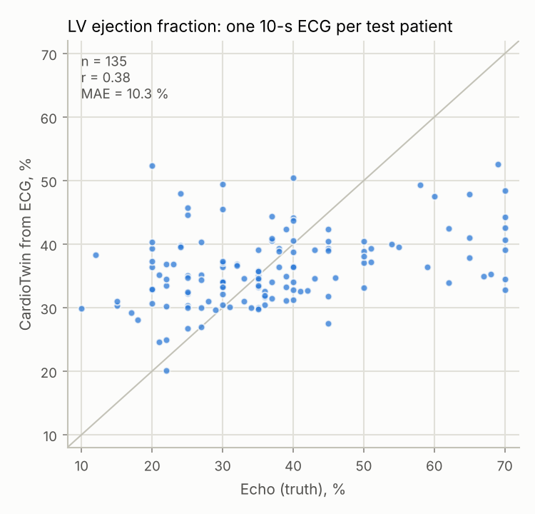
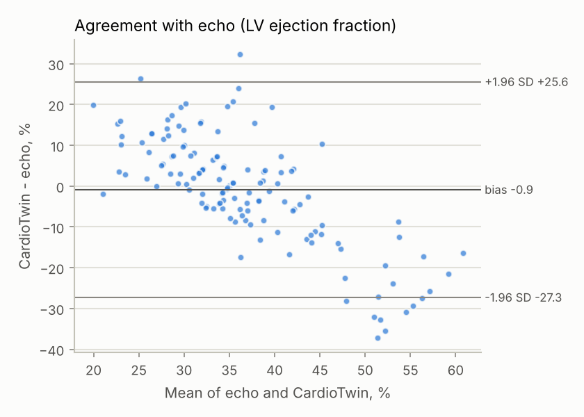
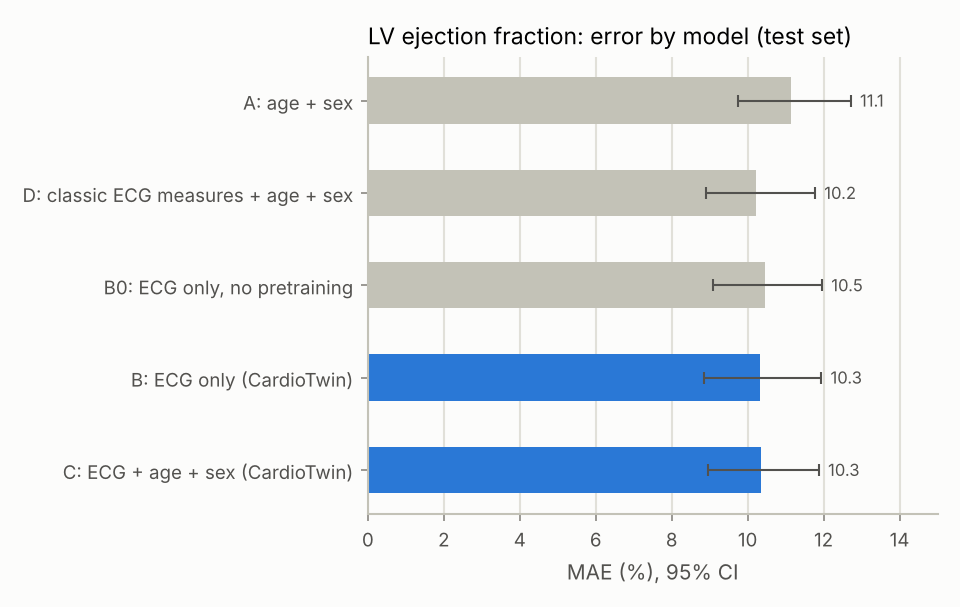
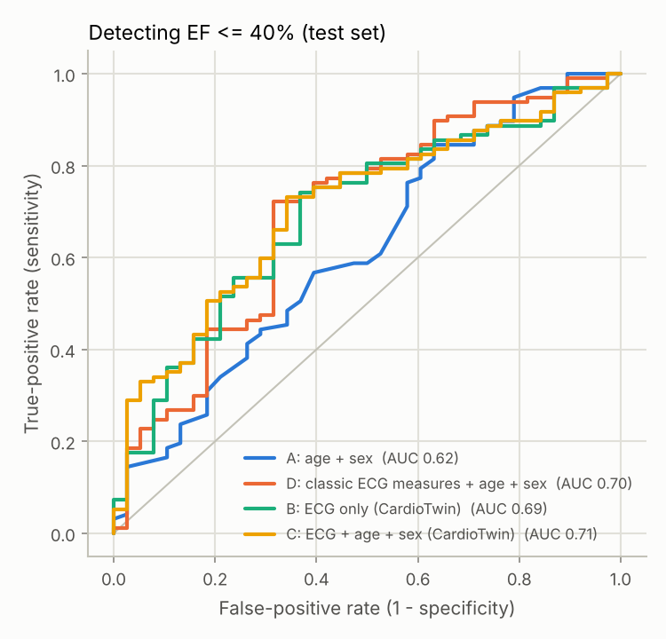
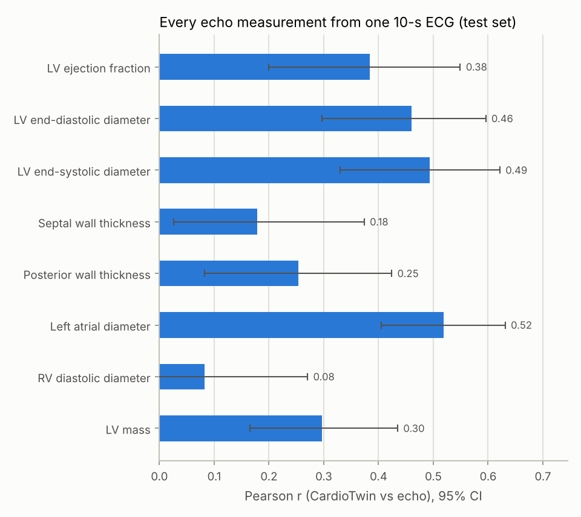
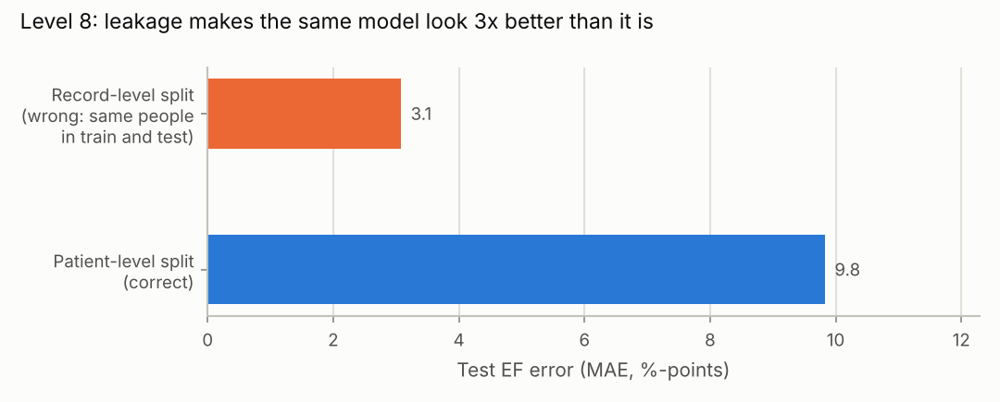
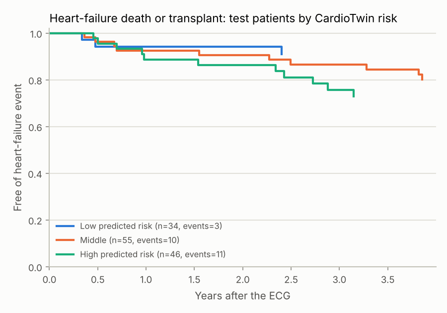
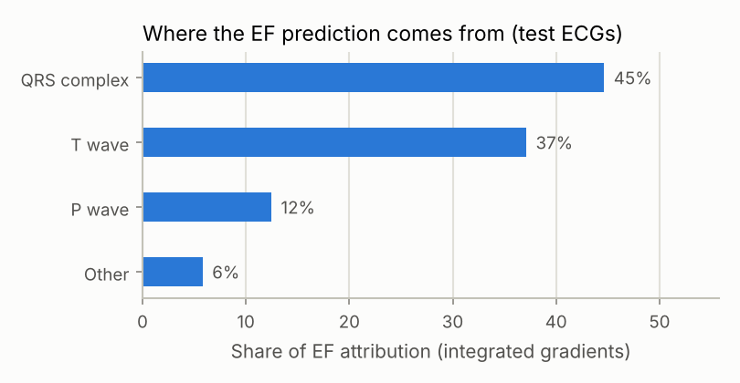
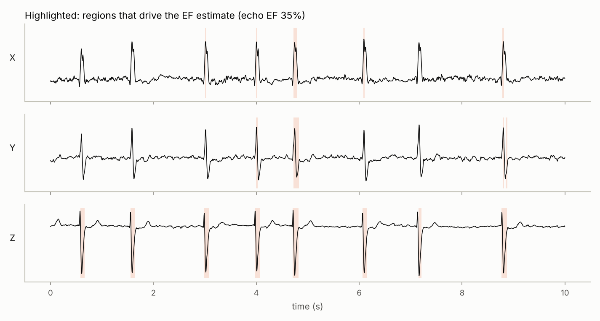

# CardioTwin on MUSIC: echocardiogram estimates from a 10-second ECG

> **Research use only.** CardioTwin is a research model. It is not a medical device, has not been clinically validated, and must not be used to diagnose or treat anyone.

Dataset: **MUSIC (Sudden Cardiac Death in Chronic Heart Failure), PhysioNet**. 992 ambulatory chronic heart-failure patients from 8 Spanish hospitals; 687 have a high-resolution orthogonal-lead (X/Y/Z, 1000 Hz) ECG. Echo measurements (LVEF, LV diameters, wall thickness, left atrial and right ventricular size) and ~4 years of follow-up for cardiac death and transplantation. Open access (ODbL). Martin-Yebra A, Martinez JP, Laguna P. PhysioNet, doi:10.13026/z3m7-rf58.

## Cohort

| | Patients | ECGs | Age, mean (SD) | Male | EF, mean (SD) | EF <= 40% |
|---|---|---|---|---|---|---|
| Development | 550 | 550 | 63.8 (11.7) | 72% | 36.7 (13.9) | 75% |
| Test | 135 | 135 | 65.9 (12.2) | 79% | 37.1 (14.7) | 72% |

Measurements available (development + test): LV ejection fraction n=685, LV end-diastolic diameter n=684, LV end-systolic diameter n=599, Septal wall thickness n=681, Posterior wall thickness n=680, Left atrial diameter n=683, RV diastolic diameter n=631, LV mass n=680.

## How the experiment was run

* **Patient-level split (Level 8).** 20% of patients form a held-out test set, stratified by LV ejection fraction. Nobody in the test set contributed a single ECG to training or model selection.
* **5-fold patient-level cross-validation** on the remaining development patients. Each fold trains one 1-D ResNet with early stopping on its validation fold; the 5 networks are averaged as an ensemble for the test set. Out-of-fold predictions feed the second-stage (future-risk) models.
* **Input:** one 10-second ECG window (leads X, Y, Z) resampled to 250 Hz and band-pass filtered (0.5-45 Hz). Training draws random 10-s windows from each recording; testing uses the central window, so every reported number reflects **a single 10-second ECG**.
* **Transfer learning:** the ECG encoder was first pretrained on PTB-XL (21,799 open 12-lead ECGs, converted to the same leads) to predict ~40 cardiologist ECG statements plus age and sex (PTB-XL test macro-AUROC 0.91, age MAE 8.4 y), then fine-tuned on this dataset. Model B0 is the same network trained from scratch.
* **Outputs:** every echo measurement at once (multi-task), each with a predicted uncertainty (heteroscedastic Gaussian head).
* **Statistics:** 95% confidence intervals from 1000 patient-level (cluster) bootstrap resamples; model differences use a paired bootstrap on the same resampled patients.

## Level 7 - LV ejection fraction from one 10-second ECG

Model **C: ECG + age + sex** on 135 held-out test patients:

| Metric | Value (95% CI) |
|---|---|
| Mean absolute error | 10.3 (9.0 to 11.9) % |
| Pearson r | 0.38 (0.20 to 0.55) |
| R^2 | 0.14 (-0.01 to 0.26) |
| Bias (prediction - echo) | -0.9 % |
| 95% limits of agreement | -27.3 to 25.6 % |
| AUROC for EF <= 40% (97/135 positive) | 0.71 (0.60 to 0.80) |
| AUROC for EF <= 50% (113/135 positive) | 0.77 (0.67 to 0.86) |
| *Averaging 9 windows per recording:* MAE / r | 10.3 % / 0.39 |




## Level 9 - Does the ECG add information beyond age and sex?

| Model | MAE (%) | Pearson r | R^2 | AUROC EF <= 40% |
|---|---|---|---|---|
| A: age + sex | 11.1 (9.8 to 12.7) | 0.22 (0.01 to 0.42) | 0.04 (-0.03 to 0.09) | 0.62 (0.51 to 0.73) |
| D: classic ECG measures + age + sex | 10.2 (8.9 to 11.8) | 0.42 (0.29 to 0.54) | 0.17 (0.06 to 0.26) | 0.70 (0.59 to 0.79) |
| B0: ECG only, no pretraining | 10.5 (9.1 to 12.0) | 0.42 (0.28 to 0.56) | 0.16 (0.07 to 0.24) | 0.68 (0.58 to 0.78) |
| B: ECG only | 10.3 (8.8 to 11.9) | 0.37 (0.19 to 0.53) | 0.14 (-0.02 to 0.26) | 0.69 (0.59 to 0.80) |
| C: ECG + age + sex | 10.3 (9.0 to 11.9) | 0.38 (0.20 to 0.55) | 0.14 (-0.01 to 0.26) | 0.71 (0.60 to 0.80) |

Paired comparisons (difference = second model minus first; negative MAE difference = better):

| Comparison | MAE difference (95% CI), p | r difference (95% CI), p | AUROC difference (95% CI), p |
|---|---|---|---|
| A: age + sex -> B: ECG only | -0.81 (-1.72 to 0.14), p=0.088 | 0.154 (-0.097 to 0.408), p=0.242 | 0.076 (-0.074 to 0.231), p=0.316 |
| A: age + sex -> C: ECG + age + sex | -0.79 (-1.68 to 0.08), p=0.070 | 0.168 (-0.071 to 0.415), p=0.188 | 0.090 (-0.053 to 0.237), p=0.224 |
| B: ECG only -> C: ECG + age + sex | 0.02 (-0.27 to 0.33), p=0.876 | 0.014 (-0.032 to 0.058), p=0.560 | 0.014 (-0.020 to 0.046), p=0.408 |
| D: classic ECG measures + age + sex -> B: ECG only | 0.11 (-0.82 to 1.09), p=0.882 | -0.051 (-0.234 to 0.142), p=0.632 | -0.003 (-0.114 to 0.123), p=0.964 |
| D: classic ECG measures + age + sex -> C: ECG + age + sex | 0.13 (-0.74 to 0.99), p=0.824 | -0.037 (-0.219 to 0.157), p=0.716 | 0.011 (-0.092 to 0.129), p=0.868 |
| B0: ECG only, no pretraining -> B: ECG only | -0.14 (-0.80 to 0.51), p=0.636 | -0.052 (-0.172 to 0.053), p=0.348 | 0.008 (-0.059 to 0.073), p=0.824 |




### Cross-validated results on the 550 development patients

Out-of-fold predictions from the 5-fold cross-validation: every development patient is predicted by a model that never saw them. With ~4x more patients than the test set these estimates are more stable, but they were also used to choose settings, so the test set above remains the headline. CardioTwin rows average the 9 windows of each recording.

| Model | LV ejection fraction MAE | LV ejection fraction r | AUROC EF <= 40% | LV end-diastolic diameter r | LV end-systolic diameter r | Left atrial diameter r | LV mass r |
|---|---|---|---|---|---|---|---|
| A: age + sex | 10.8 | 0.18 | 0.56 | 0.28 | 0.22 | 0.15 | 0.15 |
| D: classic ECG measures + age + sex | 10.2 | 0.36 | 0.70 | 0.36 | 0.38 | 0.27 | 0.34 |
| B0: ECG only, no pretraining | 9.9 | 0.40 | 0.70 | 0.33 | 0.39 | 0.04 | 0.26 |
| B: ECG only | 9.8 | 0.41 | 0.73 | 0.39 | 0.41 | 0.34 | 0.30 |
| C: ECG + age + sex | 9.7 | 0.44 | 0.75 | 0.39 | 0.43 | 0.33 | 0.30 |

## Level 10 - The whole heart from one ECG

| Measurement | n (test) | MAE | Pearson r (95% CI) | R^2 | 90% interval coverage | Uncertainty tracks error (Spearman) |
|---|---|---|---|---|---|---|
| LV ejection fraction (%) | 135 | 10.3 | 0.38 (0.20 to 0.55) | 0.14 | 88% | 0.33 |
| LV end-diastolic diameter (mm) | 135 | 7.2 | 0.46 (0.30 to 0.60) | 0.20 | 91% | 0.07 |
| LV end-systolic diameter (mm) | 123 | 8.7 | 0.49 (0.33 to 0.62) | 0.24 | 90% | 0.05 |
| Septal wall thickness (mm) | 135 | 2.1 | 0.18 (0.03 to 0.37) | -0.00 | 89% | 0.16 |
| Posterior wall thickness (mm) | 135 | 1.7 | 0.25 (0.08 to 0.42) | 0.05 | 88% | 0.21 |
| Left atrial diameter (mm) | 135 | 5.0 | 0.52 (0.40 to 0.63) | 0.26 | 96% | -0.01 |
| RV diastolic diameter (mm) | 123 | 5.6 | 0.08 (-0.10 to 0.27) | -0.04 | 92% | 0.15 |
| LV mass (g) | 135 | 73.1 | 0.30 (0.17 to 0.43) | 0.06 | 90% | 0.12 |

ECG-only model (B), same table, Pearson r: LV ejection fraction 0.37, LV end-diastolic diameter 0.43, LV end-systolic diameter 0.49, Septal wall thickness 0.17, Posterior wall thickness 0.18, Left atrial diameter 0.49, RV diastolic diameter 0.11, LV mass 0.33.



## Level 8 - What leakage would have done

Same data, same network, same training budget; only the split differs. The record-level split cuts each recording into 10-s windows and scatters them at random, so the same people appear in training and testing.

| Split | Test windows from training patients | MAE | r | R^2 |
|---|---|---|---|---|
| Record-level (wrong) | 100% | 3.1 | 0.96 | 0.91 |
| Patient-level (correct) | 0% | 9.8 | 0.51 | 0.26 |



## Levels 12-14 - The future heart: Heart-failure death or transplant within 4 years

Second-stage Cox models fitted on the development patients (using out-of-fold CardioTwin predictions) and scored on the held-out test patients. Higher C-index = better ranking of who has an event first.

| Model | Inputs | Test C-index (95% CI) | Test events / n |
|---|---|---|---|
| Age + sex | age, sex_male | 0.51 (0.39 to 0.63) | 24 / 135 |
| Actual echo + age + sex | lvef, lvedd, la_diam, age, sex_male | 0.71 (0.60 to 0.82) | 24 / 135 |
| CardioTwin (ECG) + age + sex | pred_lvef, pred_lvedd, pred_la_diam, age, sex_male | 0.64 (0.52 to 0.76) | 24 / 135 |
| Classic ECG (QRS, HR) + age + sex | qrs_ms, heart_rate, age, sex_male | 0.63 (0.51 to 0.74) | 24 / 135 |

Observed event rate in the test set by CardioTwin risk group: Low predicted risk: 9% (3/34); Middle: 18% (10/55); High predicted risk: 24% (11/46).



## Level 15 - What part of the ECG does the model use?

Integrated-gradients attribution for the EF output on 100 test ECGs (ECG-only model): QRS complex 45%, T wave 37%, P wave 12%, other 6% of the total attribution. Blanking one lead moves the EF estimate by, on average: X 4.3 points, Y 2.8 points, Z 4.5 points.




## Level 16 - Does it work equally well for everyone? (model C: ECG + age + sex)

| Subgroup | n | MAE (%) | r | Bias | AUROC EF <= 40% |
|---|---|---|---|---|---|
| sex = F | 28 | 14.9 | 0.05 | -3.4 | 0.62 |
| sex = M | 107 | 9.2 | 0.48 | -0.2 | 0.72 |
| age_band = 60-74 | 56 | 9.4 | 0.52 | -1.2 | 0.77 |
| age_band = <60 | 40 | 9.8 | 0.50 | -0.9 | 0.80 |
| age_band = >=75 | 39 | 12.3 | 0.10 | -0.3 | 0.54 |
| rhythm = atrial fibrillation | 25 | 9.6 | 0.45 | 2.6 | 0.56 |
| rhythm = paced | 17 | 8.3 | 0.45 | 3.8 | 0.94 |
| rhythm = sinus | 91 | 11.0 | 0.35 | -2.9 | 0.71 |
| nyha = 2 | 108 | 9.6 | 0.43 | -0.5 | 0.70 |
| nyha = 3 | 27 | 13.2 | 0.26 | -2.2 | 0.72 |

Small subgroups have wide uncertainty; treat differences as hypotheses, not findings.

## Limitations

* MUSIC enrolled ambulatory patients with chronic heart failure (NYHA II-III), so most hearts are abnormal (mean EF ~37%). Accuracy in a general hospital population (e.g. MIMIC-IV) will differ.
* MUSIC ECGs are orthogonal X/Y/Z leads at 1000 Hz, not the standard 12-lead ECG; uploads of 12-lead ECGs are converted with the Kors transform, which adds a domain shift.
* Echo measurements in MUSIC come from routine clinical echocardiograms at 8 hospitals; their own measurement error (roughly 5-10 EF points between readers) limits achievable accuracy.
* The ECG and echo were obtained at study enrolment but not necessarily on the same day.
* Single dataset, no external validation; a research model, not a medical device.

## Reproduce

```bash
cardiotwin experiment configs/music.yaml
```

Total compute time: 45.6 minutes on CPU.
